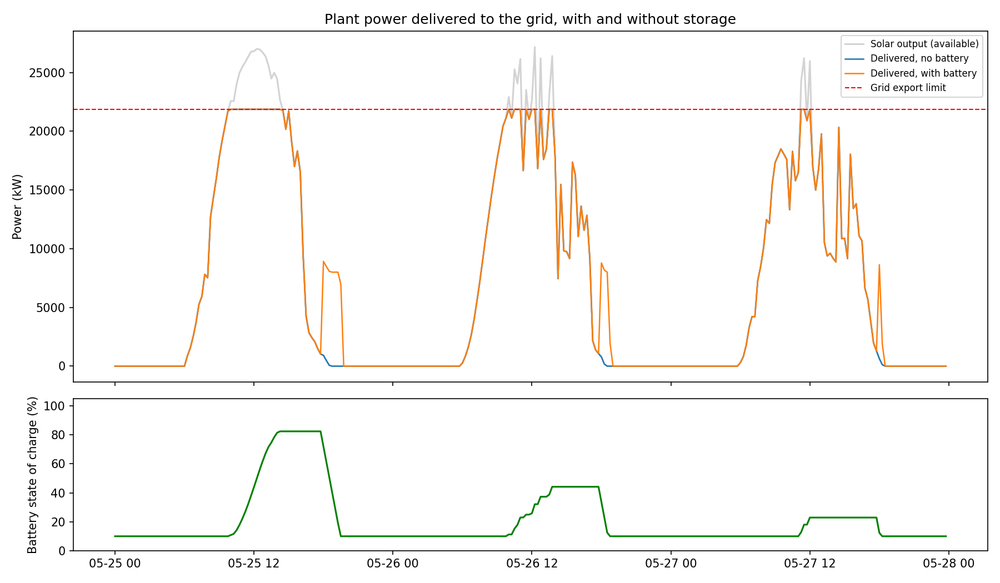
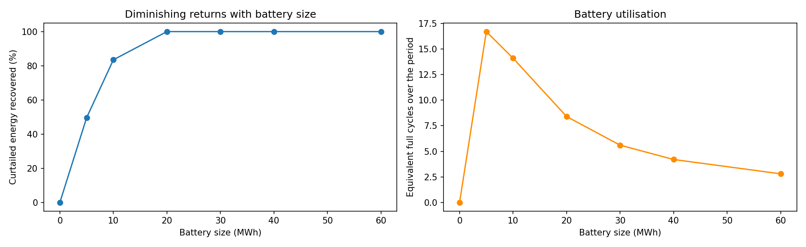

# Battery Storage Simulation for a Solar Plant

Simulates how a battery could reduce curtailed solar energy and shift it to the evening, using real plant data. Built to explore storage and flexibility in power systems with a high share of renewables.

> **Note:** the grid limit, battery size, efficiency and evening window are **simulation assumptions**, not measured data. The notebook measures energy, not money.

## Setup

- Data: Plant 1 total AC power, 34 days, 15-minute resolution.
- Grid export limit: 75% of peak output (21,863 kW).
- Main battery: 20 MWh / 8 MW, 90% round-trip efficiency, 10% minimum charge.
- Rule: charge from power above the limit, discharge between 18:00 and 22:00.

## Results

- Without storage: **187 MWh (3.5% of generation)** is curtailed.
- The 20 MWh battery recovers **100%** of it and delivers about **5.0 MWh per day** in the evening window.

| Battery (MWh) | Curtailed (MWh) | Recovered (%) | Full cycles |
|---|---|---|---|
| 0 | 187.1 | 0.0 | 0.0 |
| 5 | 94.3 | 49.6 | 16.7 |
| 10 | 30.9 | 83.5 | 14.1 |
| 20 | 0.0 | 100.0 | 8.4 |
| 30 | 0.0 | 100.0 | 5.6 |
| 40 | 0.0 | 100.0 | 4.2 |
| 60 | 0.0 | 100.0 | 2.8 |

Returns diminish quickly: most of the benefit comes from the first 10 to 20 MWh, and larger batteries sit mostly idle.

## Data

[Solar Power Generation Data](https://www.kaggle.com/datasets/anikannal/solar-power-generation-data) (Kaggle). Not included in this repository. The same dataset is used in my [solar forecasting project](https://github.com/eman774/solar-power-forecasting), which answers a different question.

## Limitations and next steps

- Assumed values, no electricity prices or battery costs, simple fixed rule, 34 days from one plant.
- Next: use solar forecasts to plan charging, add time-varying prices, test Plant 2.

## Author

Eman Hisham Ismail | [LinkedIn](https://linkedin.com/in/eman-hisham-607411283) | [Kaggle](https://kaggle.com/emanhishamismail)
